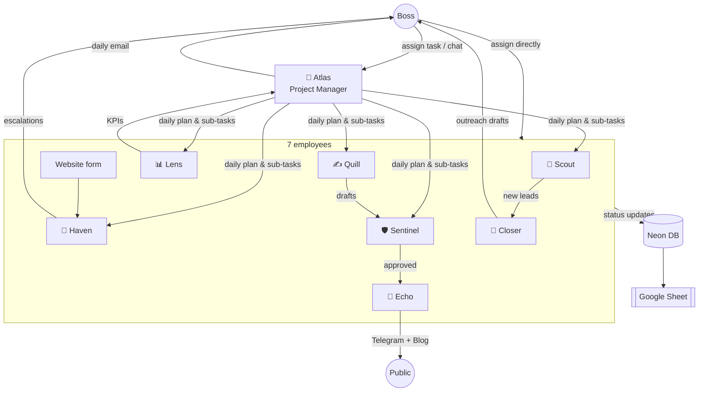

# LocalLift AI — Agency Proposal & Plan

## Proposal (Step 0)
- **Agency name and type:** LocalLift AI, an autonomous growth agency for local businesses.
- **Problem and client:** Small local businesses in Riga (cafés, salons, dental clinics, bakeries) have no time or staff for marketing, lead generation or fast customer replies. Our client is the business owner.
- **Services:**
  1. Lead discovery from Google Maps
  2. Personalised outreach drafts
  3. Social content writing and auto-publishing
  4. Customer-support replies
  5. Daily KPI reporting
- **Why it fits 7+1 AI employees:** each service is a distinct, repeatable daily job with clear inputs and outputs. A Project Manager coordinates them, audits them through a shared ledger and reports to the Boss.
- **Product:** the Growth Starter Pack, €99/month (lead audit, 3 posts per week, review replies).

## Team (inputs → outputs → KPIs)

| Employee | Responsibilities | Inputs (from) | Outputs | Tools | KPIs | Reports to → hands to |
|---|---|---|---|---|---|---|
| 🧭 **Atlas**, Project Manager | Plans the day, delegates Boss goals, audits the team, syncs the ledger, emails the daily brief, answers chat | Boss goals and chat; all task statuses | Routine tasks, sub-tasks, Sheet rows, daily email | Postgres, Apps Script (Sheets + Gmail), LiteLLM | On-time completion, blocked tasks resolved | Boss → all |
| 🔎 **Scout**, Lead Researcher | Scrapes Google Maps for local businesses | Query (Atlas/Boss) | Leads (name, category, address, phone, website, rating) | Apify crawler-google-places | Leads per day | Atlas → Closer |
| 🤝 **Closer**, Sales Strategist | Scores leads, writes outreach drafts (drafts only) | New leads (Scout) | Score, status, draft | Rules + LLM Council | Drafts ready per day | Atlas → Boss |
| ✍️ **Quill**, Content Writer | Writes LinkedIn and Telegram posts | Brief (Atlas/Boss) | Post drafts | LLM Council | Posts drafted | Atlas → Sentinel |
| 🛡️ **Sentinel**, QA & Auditor | QAs posts, flags stalled/overdue tasks, reconciles the Sheet, checks integrations | All outputs | Approvals, Blocked flags, re-sync | QA rules | Issues caught | Atlas → Echo |
| 📣 **Echo**, Publisher | Publishes approved posts | Approved posts (Sentinel) | Telegram and blog posts with links | Telegram Bot API | Posts published per platform | Atlas → Lens |
| 🛟 **Haven**, Customer Support | Triages tickets, replies, escalates | Website contact form | Resolved/escalated tickets, email replies | LLM Council, Gmail | Tickets resolved/escalated | Atlas → Boss |
| 📊 **Lens**, Performance Analyst | Computes KPIs, writes the daily report, flags bottlenecks | All tables | Daily report | SQL, LiteLLM/OpenJarvis | Reports generated | Atlas → Boss |

## Workflow diagram

## Task lifecycle
Queued → In Progress → Completed, or Blocked with a reason. Every transition is written to the database and to the Google Sheet. Sentinel marks any task stuck in progress for more than 20 minutes as Blocked.
